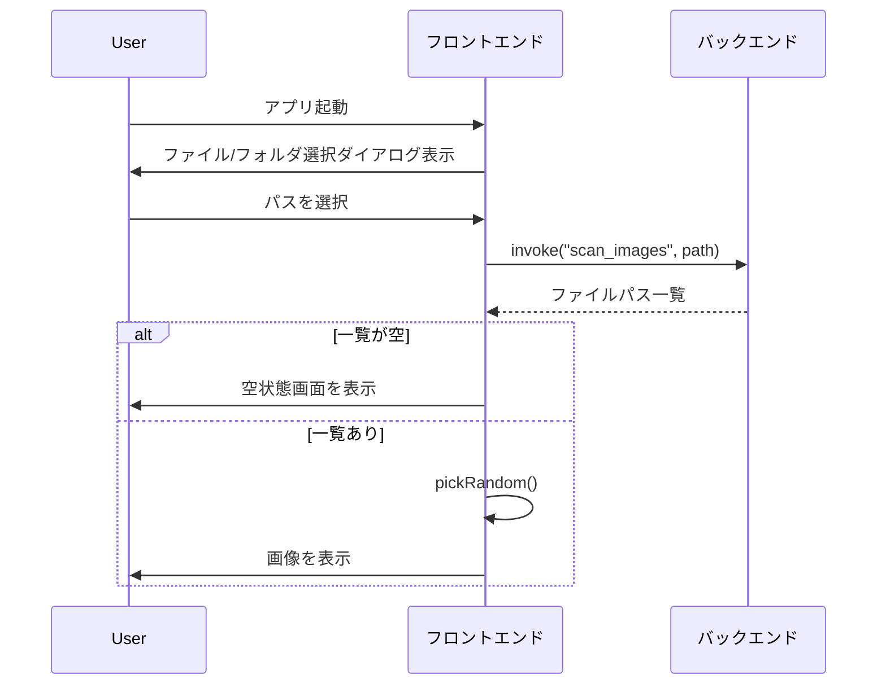
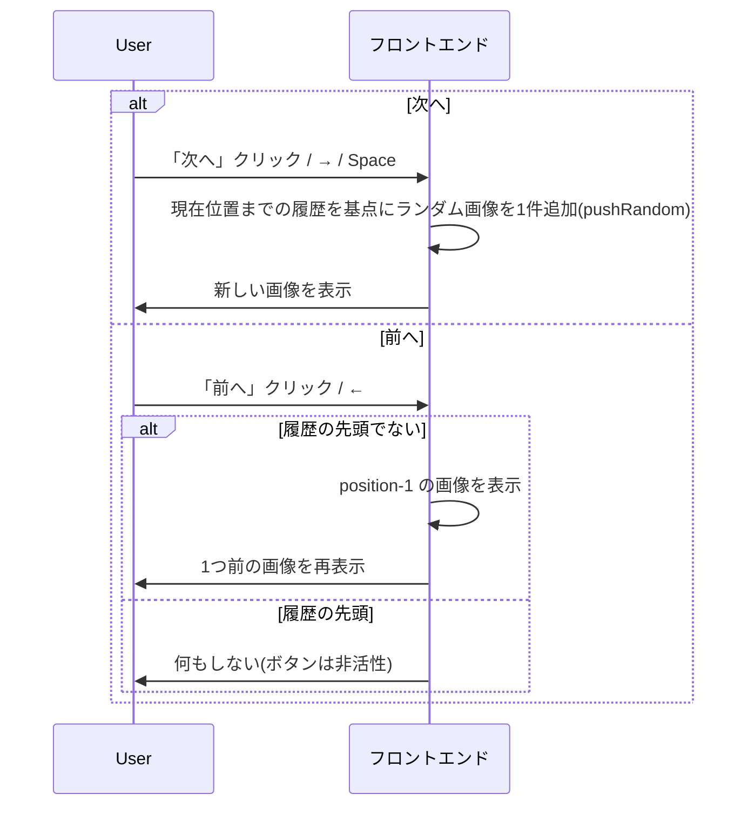
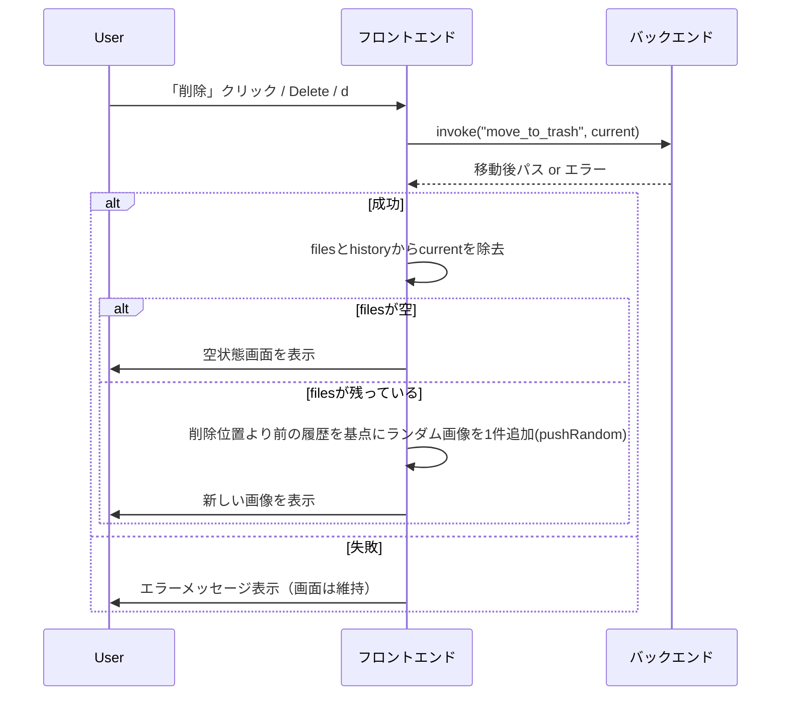

# 画像ビューアー 設計書

`requirement.md` に基づく設計。未確定事項（要件定義書 5章）については、本設計で暫定のデフォルト仕様を決定し、各所に明記する。

## 1. アーキテクチャ概要

```mermaid
flowchart LR
    subgraph Frontend["フロントエンド (Svelte + Vite)"]
        UI[画面/コンポーネント]
        Store[Svelteストア\n(ファイル一覧・現在表示)]
    end
    subgraph Backend["バックエンド (Rust / Tauri Core)"]
        Scan[scan_images]
        Trash[move_to_trash]
        Settings[get_trash_dir / set_trash_dir\nget_recent_paths / add_recent_path]
    end
    FS[(ファイルシステム)]
    Cfg[(設定ファイル\nOS設定ディレクトリ/imv/settings.json)]

    UI <--> Store
    Store -- invoke --> Scan
    Store -- invoke --> Trash
    Store -- invoke --> Settings
    Scan --> FS
    Trash --> FS
    Settings --> Cfg
    Trash -. resolve_trash_dir .-> Settings
    UI -- asset://protocol --> FS
```

- ファイル走査・削除（トラッシュ移動）など、ファイルシステムに触れる処理はすべて Rust 側の Tauri コマンドに集約する。
- ランダム選択自体は都度 IPC を呼ばず、一度取得したファイル一覧をフロントエンドのストアに保持し、JS側の `Math.random()` で選択する（毎回の「次へ」操作でバックエンド往復が発生しないようにするため）。
- 画像の表示は Tauri の asset protocol（`convertFileSrc`）を使い、任意の絶対パスの画像を `` にそのまま表示する。

## 2. プロジェクト構成

`npm create tauri-app`（Svelte + TypeScript テンプレート）で生成したため、フロントエンドは SvelteKit（SPA構成、`adapter-static`）を採用している。

```
imv/
├── src-tauri/                  # Rustバックエンド
│   ├── src/
│   │   ├── lib.rs              # エントリポイント、コマンド登録
│   │   ├── scan.rs             # ディレクトリ走査ロジック（scan_images）
│   │   ├── trash.rs            # トラッシュ移動ロジック（move_to_trash）
│   │   └── settings.rs         # トラッシュ置き場・最近開いたパスの永続化
│   ├── capabilities/default.json
│   ├── Cargo.toml
│   └── tauri.conf.json         # ウィンドウ設定・asset protocolのスコープ設定を含む
├── src/                         # SvelteKitフロントエンド
│   ├── routes/
│   │   ├── +layout.ts          # ssr = false（SPAモード）
│   │   └── +page.svelte        # ルート画面（画面状態の切り替え）
│   └── lib/
│       ├── components/
│       │   ├── CommandBar.svelte
│       │   ├── PickerView.svelte
│       │   ├── ImageViewer.svelte
│       │   ├── EmptyState.svelte
│       │   └── SettingsPanel.svelte
│       └── stores/
│           ├── imageStore.ts
│           ├── trashDirStore.ts
│           └── recentPathsStore.ts
├── package.json
└── vite.config.js
```

## 3. バックエンド設計（Rust / Tauri コマンド）

### 3.1 コマンド一覧

| コマンド名 | 引数 | 戻り値 | 説明 |
|---|---|---|---|
| `scan_images` | `path: String`（ファイル or ディレクトリの絶対パス） | `Result<Vec<String>, String>` | 対象の基準ディレクトリを決定し、配下（サブディレクトリ含む）を再帰的に走査。対応拡張子のファイル絶対パス一覧を返す |
| `move_to_trash` | `path: String`（削除対象ファイルの絶対パス） | `Result<String, String>` | ファイルを設定済みのトラッシュフォルダへ移動する。移動後の実際のパスを返す |
| `restore_from_trash` | `trashed_path: String`, `original_path: String` | `Result<String, String>` | トラッシュへ移動したファイルを元のパスへ戻す（削除の取り消し）。復元後のパスを返す |
| `get_trash_dir` | なし | `Result<String, String>` | 現在設定されているトラッシュフォルダのパスを返す（未設定時はデフォルト値） |
| `set_trash_dir` | `path: String`（新しいトラッシュフォルダの絶対パス） | `Result<(), String>` | トラッシュフォルダの保存先を設定ファイルに永続化する |
| `get_recent_paths` | なし | `Result<Vec<String>, String>` | 最近開いたフォルダ/ファイルのパス一覧を新しい順に返す |
| `add_recent_path` | `path: String`（開いたフォルダ/ファイルの絶対パス） | `Result<(), String>` | パスを履歴の先頭に記録する（重複は先頭に移動、最大件数を超えたら古いものを破棄） |

### 3.2 `scan_images` 仕様
1. 引数 `path` がファイルかディレクトリかを判定する。
   - ファイルの場合: 親ディレクトリを基準ディレクトリとする。
   - ディレクトリの場合: そのディレクトリを基準ディレクトリとする。
2. 基準ディレクトリ配下を再帰的に走査する（`walkdir` クレートを使用）。
3. 拡張子が `jpg` / `jpeg` / `png` / `gif` / `bmp` / `webp`（大文字小文字を区別しない）のファイルのみを対象とする。
4. **設計判断（要件5-2への回答）**: 隠しファイル・隠しディレクトリ（`.` で始まる）は除外する。それ以外の除外条件は設けない。
5. 走査結果が0件の場合はエラーではなく空配列 `[]` を返す（フロントエンド側で空状態を表示する）。

### 3.3 `move_to_trash` 仕様
1. トラッシュ先ディレクトリは `settings::resolve_trash_dir()`（3.5節）で決定する。存在しなければ作成する。
2. 移動先で同名ファイルが既に存在する場合、**設計判断（要件5-1への回答）**: ファイル名に連番サフィックスを付与する。
   - 例: `photo.jpg` が衝突 → `photo_1.jpg` → それも衝突していれば `photo_2.jpg` ...
3. `std::fs::rename` でファイルを移動する（同一ドライブ内を想定。将来的に異なるドライブ間移動が必要になった場合は copy＋delete にフォールバックする）。
4. 元のフォルダ階層は保持しない（トラッシュ内はフラット構成）。

### 3.3.1 `restore_from_trash` 仕様
1. `trashed_path`（`move_to_trash` が返した移動後パス）が存在しなければエラーを返す。
2. `original_path` に既にファイルが存在する場合は上書きせずエラーを返す。
3. 復元先の親フォルダが存在しなければ作成し、`std::fs::rename` で元の場所へ戻す。

### 3.4 エラーハンドリング
- パスが存在しない、権限がない、移動に失敗した等のケースは `Err(String)` としてメッセージをフロントエンドへ返し、フロントエンドはトースト等でエラーを表示する（画面遷移は行わない）。

### 3.5 設定の永続化（`settings.rs`）
- ユーザー設定は OS の設定ディレクトリ（`dirs::config_dir()`、Windowsでは `%APPDATA%`）配下の `imv/settings.json` に永続化する: `{"trash_dir": "...", "recent_paths": ["...", ...]}`。
- `load_settings()` / `save_settings()`: 設定ファイルの読み書きを共通化する内部ヘルパー。`set_trash_dir` と `add_recent_path` はどちらも一度設定全体を読み込んでから該当フィールドだけを更新して保存するため、互いの値を上書き消去しない。
- **トラッシュ置き場**
  - デフォルト: `~/tmp/Trash`（`dirs::home_dir()` + `tmp` + `Trash`）。
  - `resolve_trash_dir()`: `trash_dir` が設定されていればそれを、なければデフォルト値を返す。`move_to_trash` と `get_trash_dir` の両方から共通で利用する。
- **最近開いたパスの履歴**
  - `recent_paths`: 新しい順の配列。最大10件（`MAX_RECENT_PATHS`）。
  - `upsert_recent_path(list, path)`: 既存の同一パスがあれば取り除いてから先頭に追加し、上限を超えた分は末尾から切り捨てる（純粋関数として実装し、ファイルI/Oなしで単体テスト可能にしている）。
  - `add_recent_path` コマンドはこのヘルパーで更新した結果を保存する。

## 4. フロントエンド設計（Svelte）

### 4.1 画面構成
画面上部に常設の**コマンドバー**（`CommandBar.svelte`）を置き、主要操作をすべてここに集約する。コマンドバーの下は状態に応じたコンテンツ領域になる。

```
┌─────────────────────────────────────────┐
│ [開く▾][履歴▾][前へ][次へ][削除]     [設定] │ ← 常設コマンドバー
├─────────────────────────────────────────┤
│                                           │
│         (状態に応じたコンテンツ領域)        │
│                                           │
└─────────────────────────────────────────┘
```

コマンドバーの内容:
- **開く ▾**: クリックでドロップダウンを開き「フォルダを選択」「ファイルを選択」を表示。選択すると Tauri dialog プラグインの `open()` → `scan_images` invoke という流れは変わらない（呼び出し元がコマンドバーに移っただけ）。選択に成功したパスは `add_recent_path` で履歴に記録される。
- **履歴 ▾**: クリックでドロップダウンを開き、`recentPathsStore` が保持する最近開いたパス一覧（最大10件、新しい順）を表示する。0件の場合は「履歴はありません」と表示。項目をクリックするとそのパスを `scan_images` から開き直す（開くドロップダウンと同じ `onPick` フローを使う）。常に活性。
- **前へ**: `view === "viewing"` かつ表示履歴をさかのぼれる（`position > 0`）時のみ活性化。
- **次へ / 削除**: `view === "viewing"` の時のみ活性化。それ以外は非活性表示。
- **残り枚数**: `viewing` の時のみコマンドバー内に表示。
- **設定**: 常に活性。クリックで `SettingsPanel` をモーダル表示する。

コンテンツ領域は `view` の値に応じて次のいずれかを表示する:
1. **`picking`**: `PickerView.svelte`。「上部の『開く』から選択してください」という案内のみを表示する（要件5-5への回答：0件時も同じ案内文言で表示）。
2. **`viewing`**: `ImageViewer.svelte`。選択された画像を表示する。
3. **`empty`**: `EmptyState.svelte`。全削除済みの場合に表示（要件5-6への回答）。

### 4.2 コンポーネント構成
- `routes/+page.svelte`: 画面全体の状態（`picking`/`viewing`/`empty`）と設定パネルの表示切り替えを管理するルートコンポーネント（SvelteKitのSPA構成のため `App.svelte` 相当の役割を持つ）。
- `CommandBar.svelte`: 開く（ドロップダウン）・履歴（ドロップダウン）・前へ・次へ・削除・設定を常設するツールバー。
- `PickerView.svelte`: 案内メッセージのみを表示（操作はコマンドバーに集約したためボタンは持たない）。
- `ImageViewer.svelte`: `convertFileSrc` で現在の画像パスを URL 化し `` で表示。CSS は `object-fit: contain` で画面内に収まるよう縮小表示（拡大・パン操作は行わない。要件5-3への回答）。
- `EmptyState.svelte`: 空状態の案内メッセージのみを表示。
- `SettingsPanel.svelte`: トラッシュ置き場の表示・変更を行うモーダルパネル。

### 4.3 状態管理

`imageStore.ts`
```ts
interface ImageState {
  view: "picking" | "viewing" | "empty";
  files: string[];        // 現在保持しているファイル一覧（削除済みは都度除去）
  history: string[];      // 表示した画像パスの履歴（前へ/次へで辿る）
  position: number;       // history内で現在表示している位置
  current: string | null; // 表示中のファイルパス（= history[position]）
  error: string | null;   // scan_images / move_to_trash / restore_from_trash 失敗時のメッセージ
  undoStack: { original: string; trashed: string }[]; // 取り消し可能な削除（新しいものが末尾）
}
```
- `pickRandom(files)`: `files` からランダムに1件選ぶ（要件3.3のとおり、直前と同じ画像が再度選ばれることを許容する）。
- `pushRandom(state, historyBase)`: `historyBase` の末尾に新しいランダム画像を積んで表示する内部ヘルパー。`files` が空なら空状態にする。
- `loadFrom(path)`: `scan_images` を invoke → 0件なら `empty`、それ以外はランダムに1件選び `history=[それ]`, `position=0` として `viewing` へ。成功時は `true`、失敗時は `false` を返す（呼び出し元がこれを見て最近使ったパスの記録要否を判断する）。
- `next()`: `history.slice(0, position + 1)`（現在位置までの履歴）を基点に `pushRandom` する。「前へ」で戻った後に「次へ」を押した場合、それより先の履歴（先読み分）は破棄され、新しいランダム画像が積まれる。
- `prev()`: `position > 0` なら `position` を1つ戻し、`current` を `history[position]` に更新する（履歴自体は変更しない）。先頭では何もしない。
- `deleteCurrent()`: `move_to_trash` を invoke → 成功したら `files` から対象を除去し、`history.slice(0, position)`（削除した現在位置より前）を基点に `pushRandom` する。削除した画像は履歴からも取り除かれ、`files` が空なら空状態へ遷移する。元のパスと移動後のパスを `undoStack` に積む。
- `undoDelete()`: `undoStack` の末尾を取り出し `restore_from_trash` を invoke → 成功したら `files` に戻し、`history.slice(0, position + 1)` の末尾に復元した画像を積んで表示する（空状態からでも `viewing` に戻る）。失敗時はエラーを表示し `undoStack` は変更しない。`undoStack` は `loadFrom` / `reset` でクリアする（永続化しない）。

`trashDirStore.ts`
```ts
interface TrashDirState {
  path: string | null;  // 現在のトラッシュ置き場
  error: string | null;
}
```
- `load()`: `get_trash_dir` を invoke して初期値を取得する（アプリ起動時に一度呼ぶ）。
- `set(path)`: `set_trash_dir` を invoke して永続化し、ストアの値を更新する。

`recentPathsStore.ts`
```ts
interface RecentPathsState {
  paths: string[]; // 最近開いたパス（新しい順、最大10件）
  error: string | null;
}
```
- `load()`: `get_recent_paths` を invoke して一覧を取得する（アプリ起動時、および `record()` 後に呼ぶ）。
- `record(path)`: `add_recent_path` を invoke して履歴に記録し、`load()` で一覧を再取得する。`+page.svelte` の `handlePick` から `imageStore.loadFrom(path)` が成功した場合にのみ呼ばれる（存在しない/無効なパスは履歴に残さないため）。

### 4.4 操作方法（要件5-4への回答）
マウス操作（コマンドバーのボタンクリック）に加えて、以下のキーボードショートカットを設ける。
| キー | 動作 |
|---|---|
| `←` | 前へ |
| `→` または `Space` | 次へ |
| `Delete` または `d` | 削除 |
| `u` | 直近の削除を取り消す（表示中・空状態のどちらでも有効。複数回さかのぼれる） |

設定パネル表示中、およびテキスト入力欄にフォーカスがある間はショートカットを無効にする。

### 4.5 ウィンドウ仕様（要件5-3への回答）
- 初期サイズ: 1024×768、リサイズ可能。
- フルスクリーンの明示的な切り替えボタンは設けない（OS標準の最大化を利用）。
- 画像は常にアスペクト比を保持したまま画面内に収まるよう表示する。

### 4.6 GIFアニメーション（要件5-8への回答）
`` タグは GIF を標準でアニメーション再生するため、特別な実装は行わずアニメーションとして再生する。

### 4.7 状態の永続化（要件5-7への回答）
アプリ終了時の状態（選択していたフォルダ、表示位置など）は保持しない。起動のたびに毎回フォルダ/ファイルを選択し直す。

## 5. 主要処理フロー

### 5.1 起動〜初回表示


### 5.2 「次へ」「前へ」操作


### 5.3 「削除」操作


## 6. Tauri設定上の注意点
- Tauri v2 の asset protocol はデフォルトで任意パスへのアクセスが許可されていないため、`capabilities` 設定でユーザーが選択した任意のディレクトリを読み取れるようスコープを許可する必要がある（起動時に選択されたディレクトリを動的にスコープへ追加する、または `fs` スコープを広めに設定する）。
- `dialog` プラグイン（`tauri-plugin-dialog`）を依存に追加する。

## 7. 要件定義書「未確定事項」への対応まとめ

| # | 項目 | 本設計での決定 |
|---|---|---|
| 5-1 | トラッシュ内の同名ファイル衝突 | 連番サフィックス付与（`_1`, `_2`...）。デフォルト置き場は `~/tmp/Trash`、設定画面から変更可能・永続化 |
| 5-2 | 走査時の除外条件 | 隠しファイル/隠しディレクトリのみ除外 |
| 5-3 | ウィンドウ仕様 | 初期1024×768・リサイズ可、拡大縮小/パン操作は無し |
| 5-4 | 操作方法 | マウス（コマンドバー）＋キーボードショートカット（←=前へ, →/Space=次へ, Delete・d=削除, u=削除の取り消し） |
| 5-5 | 対象0件時の挙動 | 空状態画面を表示 |
| 5-6 | 全削除後の挙動 | 空状態画面を表示（フォルダ再選択可） |
| 5-7 | 状態の永続化 | 行わない（毎回選択し直す） |
| 5-8 | GIFアニメーション | アニメーションとして再生 |

これらはいずれも実装を進める上での暫定判断であり、要望があれば変更可能。
